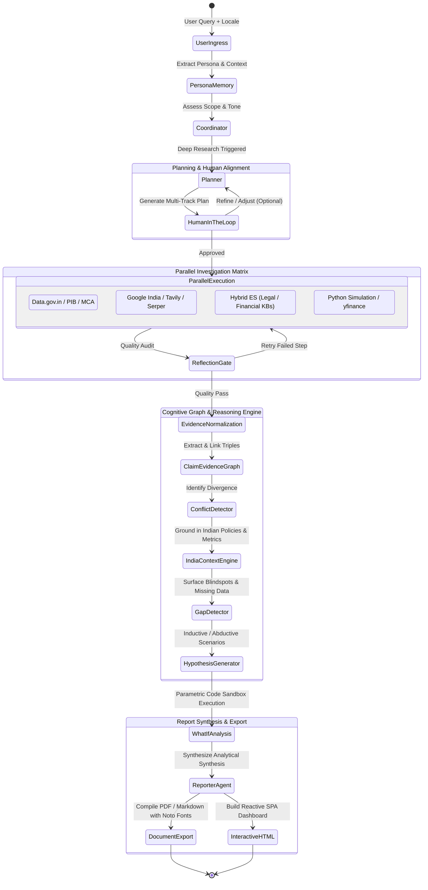
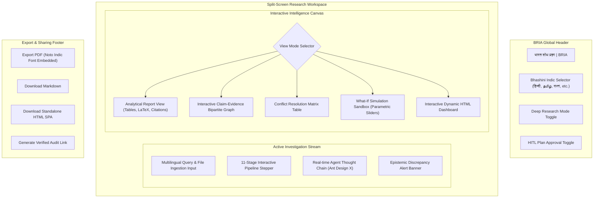

# Bharat Research Intelligence Agent (BRIA) — Architecture Specification
**Codename:** भारत शोध प्रज्ञा (Bharat Shodh Pragya)  
**System Classification:** Autonomous Epistemic Research & Strategic Intelligence Platform  
**Target Domain:** India-First Enterprise, Policy, Financial, Scientific, and Strategic Research  

---

## 1. Executive Summary & Philosophy

**Bharat Research Intelligence Agent (BRIA)** is an enterprise-grade autonomous research platform engineered specifically for the Indian socio-economic, regulatory, financial, and multilingual landscape. While inspired by graph-based multi-agent execution frameworks, BRIA fundamentally elevates autonomous research from simple "search-and-summarize" scraping to a **rigorous, verifiable, conflict-aware, and hypothesis-driven cognitive pipeline**.

### Core Value Propositions
1. **Epistemic Verifiability**: Every statement is grounded in an explicit **Claim-Evidence Graph** with source provenance, reliability weighting, and cross-source verification.
2. **Contradiction & Conflict Resolution**: Explicitly detects statistical discrepancies, diverging viewpoints, and conflicting claims between government databases, industry filings, academic publications, and news outlets.
3. **India Context Grounding**: Deeply aware of Indian administrative hierarchies, regulatory frameworks (RBI, SEBI, MCA, GST, DPDP Act 2023), fiscal calendars (April–March), economic nomenclature (Lakhs/Crores), and socio-cultural nuances.
4. **Predictive & What-If Scenario Modeling**: Beyond historical data analysis, BRIA formulates testable hypotheses and executes quantitative sensitivity/simulation models in secure isolated sandboxes.
5. **Multilingual Sovereignty**: Built for 22 scheduled Indian languages via the **Bhashini (National Language Translation Mission)** integration, ensuring equitable research access across vernacular languages.

---

## 2. Core 11-Stage Cognitive Pipeline

BRIA operates on an 11-stage deterministic state graph orchestrated via an asynchronous, backpressure-managed reactive execution engine:

```mermaid
flowchart TD
    S0["1. USER INGRESS & INTENT GROUNDING\n(Multilingual Bhashini Layer + Role Persona)"] --> S1["2. BHARAT RESEARCH PLANNER\n(Sub-Topic Decomposition + Empirical/Policy/Data Tracks)"]
    S1 --> S2["3. MULTI-AGENT AUTONOMOUS RESEARCH\n(Parallel Workers: Sovereign Data + Web + Sandbox Coder)"]
    S2 --> S3["4. EVIDENCE NORMALIZATION\n(Lakhs/Crores, FY Calendar, Metric & Schema Standardization)"]
    S3 --> S4["5. CLAIM-EVIDENCE BIPARTITE GRAPH\n(Claim Extraction, Provenance Binding & Node Linkage)"]
    S4 --> S5["6. CONFLICT & CONTRADICTION DETECTOR\n(Statistical Divergence & Cross-Source Fact Reconciliation)"]
    S5 --> S6["7. INDIA CONTEXT ENGINE\n(Federal/State Dynamics, Regulatory & Socio-Economic Grounding)"]
    S6 --> S7["8. RESEARCH GAP & UNCERTAINTY DETECTOR\n(Data Freshness, Missing Datasets, Unverified Assertions)"]
    S7 --> S8["9. HYPOTHESIS & SCENARIO GENERATOR\n(Abductive Reasoning, Causal Links & Strategic Inferences)"]
    S8 --> S9["10. WHAT-IF & STRESS SIMULATION\n(Dockerized Python Monte Carlo, Sensitivity & Fiscal Modeling)"]
    S9 --> S10["11. FINAL RESEARCH INTELLIGENCE REPORT\n(Interactive SPA Dashboard, Executive Matrix, Verified Citations, PDF/MD)"]

    classDef stage fill:#1e293b,stroke:#38bdf8,stroke-width:2px,color:#f8fafc;
    class S0,S1,S2,S3,S4,S5,S6,S7,S8,S9,S10 stage;
```



---

## 3. Stage-by-Stage Pipeline Architecture



### Stage 1: User Ingress & Intent Grounding
* **Multilingual Ingress**: Supports natural language queries in English and 22 Indian languages. Inbound queries are normalized through a high-performance **Bhashini Language Gateway** to extract intent, language metadata, and domain terminology.
* **Short-Term Persona & Role Memory (`ShortUserRoleMemoryNode`)**:
  * Extracts user domain persona (e.g., *Policy Researcher, Equity Analyst, Legal Counsel, Tech Founder*).
  * Adjusts response depth, analytical framework (SWOT, PESTLE, Porter's Five Forces, Econometric), and formatting tone.
  * Maintains thread continuity via Redis sliding-window session memory.

### Stage 2: Bharat Research Planner
* **Dynamic Multi-Track Planning (`BharatPlannerNode`)**:
  * Deconstructs complex inquiries into mutually exclusive, collectively exhaustive (MECE) research tracks:
    1. **Empirical Data Track**: Historical time-series data, macroeconomic indicators.
    2. **Regulatory & Policy Track**: Government notifications, gazettes, acts, judicial precedents.
    3. **Market & Industry Track**: Sectoral benchmarks, corporate financial filings.
    4. **Socio-Cultural Track**: Regional variations, demographic impact assessments.
* **Human-In-The-Loop (HITL) Gate**: Interrupts execution to display the proposed research blueprint to the user via SSE. Users can approve, add specific directives, or modify data sources before execution proceeds.

### Stage 3: Multi-Agent Autonomous Research Fleet
Dynamic parallel execution utilizing dedicated worker pools:
* **Sovereign Data Specialist (`SovereignDataAgent`)**: Scrapes and queries verified Indian official data repositories (`data.gov.in`, `pib.gov.in`, `mca.gov.in`, `rbi.org.in`, `sebi.gov.in`).
* **Web Intelligence Specialist (`WebResearchAgent`)**: Performs multi-query broad searches with localized Indian domain weighting (`website-weight-config.json`).
* **Hybrid Domain RAG Specialist (`BharatRagAgent`)**: Searches ingested private collections (e.g., internal company filings, Indian Kanoon judicial archives, statutory books) using Dense kNN + Sparse BM25 + Reciprocal Rank Fusion.
* **Quantitative Data Coder (`CoderAgent`)**: Spins up isolated Docker containers to fetch financial instruments, parse datasets, execute statistical regressions, and generate charts.
* **Self-Reflection Gatekeeper (`ReflectionProcessor`)**: Audits every subtask output against factual clarity, completeness, and evidence adequacy. If quality thresholds fail, it loops back with actionable feedback for up to $N$ attempts.

### Stage 4: Evidence Normalization
* **Unit & Currency Standardization**: Converts all foreign and mixed notations into the Indian standard:
  * Millions/Billions $\to$ **Lakhs (₹1,00,000) / Crores (₹1,00,00,000)**.
  * Standardizes fiscal timeframes to Indian **Fiscal Years (FY April 1 – March 31)**.
* **Temporal & Geographic Geo-Tagging**: Tags every evidence chunk with its temporal validity period and geographic scope (All-India, State-level, Tier-1/2/3 cities, Rural/Urban).
* **Source Credibility Tiering**:
  * **Tier 1 (Official / Regulatory)**: `*.gov.in`, RBI, SEBI, Supreme Court, BSE/NSE filings.
  * **Tier 2 (Reputable Research)**: NITI Aayog, ICRIER, ORF, Bloomberg, Reuters, CRISIL, ICRA.
  * **Tier 3 (General Media / Industry)**: Verified news publications, trade press.
  * **Tier 4 (Unverified / Social)**: Blogs, forums (marked with cautionary flags).

### Stage 5: Claim-Evidence Bipartite Graph
Transforms unstructured findings into a verifiable directed bipartite graph:
* **Claim Nodes ($C_i$)**: Atomic factual or analytical assertions extracted from research text.
* **Evidence Nodes ($E_j$)**: Raw text excerpts, table rows, or data points linked to source URLs, authors, and timestamps.
* **Relation Edges**:
  * `SUPPORTS` (with confidence weight $w \in [0, 1]$)
  * `REFUTES` (direct negative contradiction)
  * `QUALIFIES` (adds boundary conditions or caveats)
* Enables complete traceability: users can click any sentence in the final report to inspect the exact underlying evidence nodes.

### Stage 6: Epistemic Conflict & Contradiction Detector
* **Statistical Divergence Identification**: Detects discrepancies across data sources (e.g., Ministry estimate of GDP growth vs. IMF estimate vs. private brokerage report).
* **Narrative Conflict Analysis**: Highlights policy debates (e.g., Industry body perspective vs. Environmental regulatory stance).
* **Conflict Matrix Generation**: Outputs a structured reconciliation table presenting:
  1. Competing Claims
  2. Sources & Credibility Tiers
  3. Root Cause of Variance (e.g., differing base years, methodology divergence, reporting lag)
  4. Synthesized Consensus / Probability Assessment

### Stage 7: India Context & Policy Engine
Grounds raw research within Indian socio-economic and regulatory reality:
* **Federal vs. State Lens**: Highlights Union list, State list, and Concurrent list policy nuances (e.g., Land and Police are State subjects; Corporate Tax is Central).
* **Regulatory Compliance Frameworks**:
  * **DPDP Act 2023**: Data protection and digital privacy considerations.
  * **FDI / FEMA Regulations**: Sectoral caps, DPIIT guidelines.
  * **GST / Fiscal Dynamics**: Input tax credit implications, state GST variations.
* **Demographic & Socio-Economic Nuance**: Considers Digital Public Infrastructure (DPI - Aadhaar, UPI, ONDC, OCEN), purchasing power parity, and regional disparities.

### Stage 8: Research Gap & Uncertainty Detector
* Audits the accumulated evidence graph to find **Blindspots and Information Voids**:
  * Missing geographical coverage (e.g., data available only for Maharashtra and Karnataka, missing North-East).
  * Outdated metrics (e.g., relying on 2011 Census figures in absence of recent surveys).
  * Unverified assumptions lacking Tier-1/Tier-2 backing.
* Explicitly states epistemic limitations under a dedicated **"Research Uncertainties & Blindspots"** report section.

### Stage 9: Hypothesis & Scenario Generator
* Uses **Abductive and Inductive Reasoning** to formulate forward-looking hypotheses:
  * **Base Case Scenario (Expected Path)**: Most probable trajectory based on current regulatory momentum and empirical trends.
  * **Bull / Optimistic Scenario (Accelerated Growth)**: Catalysts, policy reforms, foreign investment inflows.
  * **Bear / Stress Scenario (Downside Risks)**: Geopolitical shocks, monsoonal variations, currency volatility, regulatory bottlenecks.
* Outlines the key leading indicators that would confirm or invalidate each hypothesis.

### Stage 10: What-If & Stress Simulation
* **Parametric Simulation Engine (`WhatIfAnalyzer`)**:
  * Converts identified scenarios into quantitative Python models executed inside the secure Docker Sandbox.
  * **Simulation Capabilities**:
    * Monte Carlo simulations for financial projections and market sizing.
    * Sensitivity analysis on key parameters (e.g., crude oil price shift $\pm 15\%$, interest rate hike $+50$ bps, GST rate revisions).
    * Supply chain and inflation impact modeling.
  * Generates structured CSV/JSON data and Matplotlib/Chart.js parameter configurations for visual rendering.

### Stage 11: Final Research Intelligence Report
* **Executive Presentation**:
  * **Strategic Executive Summary**: High-impact insights and actionable recommendations.
  * **Comprehensive Deep-Dive Modules**: Multi-dimensional thematic analysis.
  * **Evidence Provenance Matrix**: Traceable claim-evidence citations.
  * **What-If Simulation Dashboards**: Embedded interactive parameter sliders and charts.
* **Multi-Format Export**:
  * **Interactive Dynamic SPA**: Client-side single-page dashboard with Tailwind CSS and Chart.js.
  * **Publication-Grade PDF**: Formatted with Google Noto Sans Indic typography, clean table layouts, and headers.
  * **Standard Markdown**: Clean, interoperable technical documentation.

---

## 4. System Architecture & Component Design

```
+-----------------------------------------------------------------------------------+
|                           PRESENTATION LAYER (ui-vue3)                            |
|  +-----------------------------------------------------------------------------+  |
|  |  BRIA Research Cockpit (Vue 3, Pinia, Ant Design X Vue, Tailwind CSS)       |  |
|  |  * Multilingual Switcher (22 Indic Languages + English)                      |  |
|  |  * Real-Time 11-Stage Pipeline Graph Visualizer                             |  |
|  |  * Claim-Evidence Bipartite Graph Inspector                                 |  |
|  |  * Conflict & Contradiction Resolution Matrix                               |  |
|  |  * Interactive What-If Simulation Sandbox (Sliders + Real-time Re-run)      |  |
|  |  * Dual-Mode Report Viewer (Markdown Table View & Interactive HTML SPA)      |  |
|  +-----------------------------------------------------------------------------+  |
+------------------------------------------+----------------------------------------+
                                           | SSE Stream & REST API
+------------------------------------------v----------------------------------------+
|                      APPLICATION & API INGRESS LAYER                              |
|  +----------------------+ +---------------------+ +----------------------------+  |
|  | BharatChatController | | BharatReportControl | | BharatKnowledgeController  |  |
|  | (/chat/stream,resume)| | (/api/reports/*)    | | (/api/rag/ingest,upload)   |  |
|  +----------------------+ +---------------------+ +----------------------------+  |
+------------------------------------------+----------------------------------------+
                                           | Reactive Event Stream
+------------------------------------------v----------------------------------------+
|                   SPRING AI BHARAT STATE GRAPH ORCHESTRATION                      |
|  +-----------------------------------------------------------------------------+  |
|  | BharatStateGraph (Backpressure Buffers, Checkpointing, Interrupt Handling) |  |
|  +-----------------------------------------------------------------------------+  |
|  |  Nodes:                                                                     |  |
|  |  [01] ShortUserRoleMemoryNode        [07] IndiaContextEngineNode            |  |
|  |  [02] BharatCoordinatorNode          [08] ResearchGapDetectorNode           |  |
|  |  [03] BharatPlannerNode              [09] HypothesisGeneratorNode           |  |
|  |  [04] ParallelExecutorNode           [10] WhatIfSimulationNode              |  |
|  |  [05] EvidenceNormalizationNode      [11] BharatReporterNode                |  |
|  |  [06] ClaimEvidenceGraphNode         [12] EpistemicConflictDetectorNode     |  |
|  +-----------------------------------------------------------------------------+  |
+-------------------+----------------------+-------------------+--------------------+
                    |                      |                   |
+-------------------v---+  +---------------v---+   +-----------v----+  +------------v---+
| SOVEREIGN DATA MATRIX |  | LLM GATEWAY ENGINE|   | HYBRID RAG     |  | DOCKER SANDBOX |
| * Data.gov.in API     |  | * Sarvam AI       |   | * Elasticsearch|  | * python:3-slim|
| * PIB Press Releases  |  | * Krutrim AI      |   | * HyDe & RRF   |  | * yfinance     |
| * MCA21 / ROC Data    |  | * Google Gemini   |   | * Indic Embed  |  | * pandas/numpy |
| * BSE/NSE Disclosures |  | * Claude 3.5      |   | * Tika Ingest  |  | * statsmodels  |
| * Indian Kanoon RAG   |  | * Bhashini Trans  |   | * BM25 + kNN   |  | * indic-nlp    |
+-----------------------+  +-------------------+   +----------------+  +----------------+
```

---

## 5. Sovereign Indian Data & Knowledge Matrix

BRIA includes purpose-built connectors and pre-configured domain scrapers:

| Domain | Data Provider / Source | Ingestion & Access Mechanism | Reliability Tier |
| :--- | :--- | :--- | :--- |
| **Government & Demographics** | **Data.gov.in (OGD Platform India)** | REST API with API Key authentication. Datasets on agriculture, census, health, trade. | **Tier 1 (Official)** |
| **National Policy & Statements** | **PIB (Press Information Bureau)** | Automated scraper & RSS ingest for official Cabinet decisions and fact-checks. | **Tier 1 (Official)** |
| **Corporate Governance & Filings**| **MCA21 / Registrar of Companies** | Company master data, registered capital, director disqualification lists. | **Tier 1 (Official)** |
| **Financial & Capital Markets** | **BSE India, NSE India, SEBI** | Real-time / historical stock data, corporate announcement disclosures, insider trading filings. | **Tier 1 (Official)** |
| **Judicial & Legal Jurisprudence**| **Indian Kanoon & e-Courts** | Vectorized landmark rulings from Supreme Court of India, High Courts, and Tribunals (NCLT, ITAT). | **Tier 1 (Official)** |
| **Macroeconomics & Banking** | **Reserve Bank of India (RBI) Database** | Handbook of Statistics on the Indian Economy (HSIE), DBIE portal, Monetary Policy Reports. | **Tier 1 (Official)** |
| **Academic & Scientific Research**| **Shodhganga (INFLIBNET) & NIScPR** | Indian electronic theses, CSIR journals, and national patent databases. | **Tier 2 (Academic)** |
| **Geospatial & Logistics** | **MapmyIndia (Mappls API)** | MCP Server for Indian PIN codes, route logistics, district boundaries, and spatial analytics. | **Tier 1 (Official)** |

---

## 6. Prompt Engineering & Cognitive Framing

All system prompts in BRIA are crafted to enforce deep analytical rigor, Indian terminology, and zero hallucination.

### Key Prompt Templates

#### 1. `planner.md` — Bharat Research Planner
```markdown
---
CURRENT_TIME: {{ CURRENT_TIME }}
TIMEZONE: Asia/Kolkata (IST)
LOCALE: {{ LOCALE }}
---
You are the Chief Research Strategist of Bharat Research Intelligence Agent (BRIA).
Your mission is to formulate an exhaustive, multi-track research blueprint for the given inquiry.

### CORE PLANNING RULES:
1. Deconstruct the objective into MECE (Mutually Exclusive, Collectively Exhaustive) tracks:
   - Empirical & Historical Data Track
   - Policy, Statutory & Regulatory Track (BNS, RBI, SEBI, GST, DPDP Act)
   - Industry, Capital Markets & Competitive Track
   - Regional & Socio-Demographic Track
2. For each step, declare:
   - `step_type`: "research" (search & data retrieval) OR "processing" (calculation, python script, simulation).
   - `data_source_category`: "sovereign_gov", "financial_markets", "legal_judiciary", "academic_scientific", or "general_web".
   - `target_metrics`: Exact numerical or qualitative metrics to extract.
   - `need_web_search`: boolean.
3. Apply Indian economic standards (Lakhs/Crores, FY cycles, INR).
4. Output strictly structured JSON conforming to the `BharatPlan` schema.
```

#### 2. `conflict_detector.md` — Epistemic Conflict Detector
```markdown
---
ROLE: Chief Epistemic Auditor & Fact Reconciliation Engine
---
You are evaluating a collection of claims and evidence gathered across multiple sources on: "{{ TOPIC }}".

### YOUR TASK:
1. Cross-examine all claims to detect:
   - Numerical Discrepancies (e.g., Source A states market size is ₹45,000 Cr; Source B states ₹28,000 Cr).
   - Methodological Divergences (e.g., differing sample sizes, base year variation, formal vs informal sector scope).
   - Policy & Sentiment Contradictions.
2. Produce a Conflict Reconciliation Matrix:
   - Claim A vs Claim B
   - Sources & Credibility Tiers
   - Root Cause of Difference
   - Most Probable Consensus / Confidence Interval
```

#### 3. `india_context.md` — India Policy & Economic Grounding Engine
```markdown
---
ROLE: Principal Policy Advisor on Indian Affairs
---
Ground the extracted research findings within the structural realities of India:
1. Federal Structure: Identify whether the matter falls under Central List, State List, or Concurrent List.
2. Digital Public Infrastructure (DPI): Assess how India Stack (Aadhaar, UPI, DigiLocker, ONDC) impacts this sector.
3. Regulatory Compliance: Cross-reference relevant statutory frameworks:
   - Corporate/Tax: Companies Act 2013, GST Acts, Income Tax Act 1961
   - Data & Tech: Digital Personal Data Protection (DPDP) Act 2023, IT Rules 2021
   - Financial: RBI Master Directions, SEBI LODR Regulations
4. Standardize all economic values into Indian Rupee (₹), Lakhs, and Crores.
```

#### 4. `what_if_analyzer.md` — Parametric Simulation Specialist
```markdown
---
ROLE: Quantitative Modeling & Scenario Specialist
---
Given the research findings and identified forward-looking scenarios for "{{ TOPIC }}":
1. Write a self-contained, robust Python 3 script to perform sensitivity and Monte Carlo simulations.
2. The script must:
   - Define baseline parameters and reasonable variance ranges.
   - Run 1,000+ simulation iterations or parametric stress test calculations.
   - Compute P10, P50 (Median), and P90 outcome distributions.
   - Print clean JSON outputs to stdout with simulation metrics and Chart.js dataset configs.
3. Restrict code to approved libraries: `numpy`, `pandas`, `scipy`, `statsmodels`.
```

---

## 7. Package Blueprint & Code Organization

```
src/main/java/in/gov/bharat/research/
├── BharatResearchApplication.java               # Application bootstrap
├── config/
│   ├── BharatGraphConfiguration.java            # 11-stage StateGraph construction
│   ├── BharatProperties.java                    # Global application properties
│   ├── IndicModelConfiguration.java             # Multi-provider LLM gateway (Sarvam, Gemini, Claude)
│   ├── IndicLanguageConfiguration.java          # Bhashini API integration
│   ├── PythonSandboxProperties.java             # Docker container resource limits
│   ├── SovereignDataProperties.java             # Data.gov.in, PIB, MCA API keys
│   └── export/
│       ├── ExportConfiguration.java             # File export configuration
│       └── TypographyProperties.java            # Indic Noto font configurations
├── controller/
│   ├── BharatChatController.java                # SSE streaming (/chat/stream, /chat/resume, /chat/stop)
│   ├── BharatReportController.java              # Report export and HTML SPA generation
│   ├── BharatKnowledgeController.java           # Document ingestion & RAG upload
│   └── IndicLanguageController.java             # Bhashini translation & voice endpoints
├── node/
│   ├── ShortUserRoleMemoryNode.java             # Stage 1: Persona extraction & context
│   ├── BharatCoordinatorNode.java               # Stage 1: Intent classifier & router
│   ├── BharatPlannerNode.java                   # Stage 2: Multi-track research planner
│   ├── ParallelExecutorNode.java                # Stage 3: Task assigner
│   ├── SovereignDataNode.java                   # Stage 3: Official portal scraper
│   ├── WebResearcherNode.java                   # Stage 3: Localized web search worker
│   ├── QuantitativeCoderNode.java               # Stage 3: Sandbox python runner
│   ├── EvidenceNormalizationNode.java           # Stage 4: Units, currency, calendar normalizer
│   ├── ClaimEvidenceGraphNode.java              # Stage 5: Bipartite graph constructor
│   ├── EpistemicConflictDetectorNode.java       # Stage 6: Discrepancy & conflict analyzer
│   ├── IndiaContextEngineNode.java              # Stage 7: Policy & socio-economic grounding
│   ├── ResearchGapDetectorNode.java             # Stage 8: Blindspot & uncertainty identifier
│   ├── HypothesisGeneratorNode.java             # Stage 9: Scenario & hypothesis builder
│   ├── WhatIfSimulationNode.java                # Stage 10: Docker sandbox scenario execution
│   └── BharatReporterNode.java                  # Stage 11: Final intelligence report synthesizer
├── graph/
│   ├── BharatOverAllState.java                  # Central shared state across 11 nodes
│   ├── model/
│   │   ├── ClaimEvidenceGraph.java              # Bipartite graph data structure
│   │   ├── ConflictMatrix.java                  # Conflict records & resolutions
│   │   ├── IndiaPolicyContext.java              # Policy & legal dimensions
│   │   ├── WhatIfScenarioResult.java            # Quantitative simulation output
│   │   └── BharatPlan.java                      # Multi-track plan representation
│   └── serializer/
│       └── BharatStateSerializer.java           # State serialization / checkpointing
├── rag/
│   ├── core/DefaultBharatRagProcessor.java      # Hybrid retrieval coordinator
│   ├── retriever/IndicHybridRetriever.java      # Elasticsearch dense kNN + sparse BM25
│   ├── strategy/BharatRrfFusionStrategy.java    # Reciprocal rank fusion
│   ├── transformer/IndicHyDeTransformer.java    # Hypothetical document embedding
│   └── kb/
│       ├── LegalJudiciaryKbClient.java          # Indian Kanoon & e-Courts client
│       └── FinancialDisclosuresKbClient.java    # BSE/NSE filings client
├── tool/
│   ├── DockerPythonSandboxTool.java             # Secure containerized python runner
│   ├── SovereignDataPortalTool.java             # Data.gov.in & PIB query tool
│   ├── MapmyIndiaMcpTool.java                   # Geospatial & PIN code resolver
│   └── IndicSearchFilterTool.java               # Domain-weighted search tool
└── util/
    ├── IndianCurrencyFormatter.java             # Lakhs/Crores & INR formatting
    ├── IndicDateFormatter.java                  # IST & Indian Fiscal Year utilities
    ├── BhashiniClientUtil.java                  # Bhashini translation helper
    └── export/
        ├── IndicPdfRendererUtil.java            # OpenHtmlToPdf with Noto Indic fonts
        └── InteractiveHtmlBuilder.java          # Tailwind + Chart.js SPA compiler
```

---

## 8. Data Models & Graph Schema

### 1. `ClaimEvidenceGraph` Schema
```java
public class ClaimEvidenceGraph {
    private List<ClaimNode> claims;
    private List<EvidenceNode> evidences;
    private List<RelationEdge> relations;

    public record ClaimNode(
        String claimId,
        String statement,
        String topicCategory,
        Double confidenceScore,
        List<String> entityTags
    ) {}

    public record EvidenceNode(
        String evidenceId,
        String rawSnippet,
        String sourceUrl,
        String sourceTitle,
        CredibilityTier credibilityTier,
        LocalDateTime publicationDate,
        String geographicScope
    ) {}

    public record RelationEdge(
        String claimId,
        String evidenceId,
        EdgeType type, // SUPPORTS, REFUTES, QUALIFIES
        Double weight,
        String rationale
    ) {}
}
```

### 2. `ConflictMatrix` Schema
```java
public class ConflictMatrix {
    private List<ConflictRecord> conflicts;

    public record ConflictRecord(
        String conflictId,
        String issueDescription,
        ClaimNode primaryClaim,
        ClaimNode contradictingClaim,
        VarianceCategory varianceCategory, // NUMERICAL, METHODOLOGICAL, POLICY, TEMPORAL
        String rootCauseAnalysis,
        String reconciledConsensus,
        Double consensusConfidence
    ) {}
}
```

### 3. `WhatIfSimulationResult` Schema
```java
public class WhatIfSimulationResult {
    private String scenarioName;
    private Map<String, Object> baselineParameters;
    private Map<String, Object> stressParameters;
    private DistributionMetric outcomeDistribution; // P10, P50, P90
    private String pythonCodeExecuted;
    private String executionStdout;
    private Map<String, Object> chartJsConfig;
}
```

---

## 9. Frontend Architecture (BRIA Cockpit)

The user interface in `/ui-vue3` is refactored into a high-density, professional research cockpit:



### Key UI Capabilities:
1. **11-Stage Pipeline Visualizer**: Renders live state progress across all 11 stages with node-level execution times, token counts, and parallel sub-agent statuses.
2. **Interactive Claim-Evidence Graph Viewer**: Visual network diagram where users can click any statement in the report to see the supporting, refuting, and qualifying evidence nodes with direct URLs.
3. **What-If Simulation Sliders**: Allows users to dynamically modify simulation parameters (e.g., change interest rate or crude oil price) and trigger an instant sandbox re-computation from the UI.
4. **Bhashini One-Click Vernacular Toggle**: Seamlessly translates report sections and data tables into any of the 22 scheduled Indian languages in real time.

---

## 10. Security, Data Sovereignty & DPDP Act Compliance

1. **Digital Personal Data Protection (DPDP) Act 2023 Compliance**:
   * Automatic PII (Personally Identifiable Information) masking on all ingested documents before processing (Aadhaar numbers, PAN, phone numbers, email addresses masked via regex and NER).
   * Purpose limitation and strict session-bound data lifecycle policies.
2. **Indian Sovereign Data Residency**:
   * All deployments, vector indices (Elasticsearch), Redis caches, and Docker sandbox runners strictly hosted in Indian data centers (e.g., AWS `ap-south-1` Mumbai / `ap-south-2` Hyderabad, Yotta NM1, E2E Networks).
   * Zero data exfiltration to unauthorized foreign APIs for sensitive enterprise configurations.
3. **Execution Sandbox Hardening**:
   * Ephemeral Docker containers execute with `--network=none` (unless explicit data fetch is required).
   * Strict resource quotas: max 2 CPU cores, 1024 MB RAM, 30-second execution timeout, non-root user execution, read-only root filesystems with temporary isolated `/tmp` volumes.

---

## 11. Implementation Roadmap

```
+-----------------------------------------------------------------------------------+
|                           BRIA IMPLEMENTATION ROADMAP                             |
+-----------------------------------------------------------------------------------+
|  PHASE 1: Foundation, Multi-Model Gateway & Orchestration Core                    |
|  - Refactor package structure to in.gov.bharat.research                           |
|  - Implement IndicModelConfiguration (Sarvam AI, Gemini, Claude multi-provider)    |
|  - Setup Bhashini translation client and Indic locale utilities                   |
|  - Redesign prompts to India-first framing with IST timezone & INR formatting      |
+-----------------------------------------------------------------------------------+
|  PHASE 2: Claim-Evidence Graph & Epistemic Conflict Detection                      |
|  - Implement ClaimEvidenceGraphNode and bipartite data structures                 |
|  - Implement EpistemicConflictDetectorNode and reconciliation algorithms          |
|  - Implement IndiaContextEngineNode with statutory & economic grounding           |
|  - Implement ResearchGapDetectorNode                                              |
+-----------------------------------------------------------------------------------+
|  PHASE 3: What-If Simulation Sandbox & Sovereign Data Connectors                  |
|  - Implement HypothesisGeneratorNode & WhatIfSimulationNode                       |
|  - Integrate Docker Python Sandbox with pre-warmed financial/statistical packages |
|  - Build connectors for Data.gov.in, PIB, MCA21, and Indian Kanoon                |
|  - Configure Noto Sans Indic typography for OpenHtmlToPdf export engine           |
+-----------------------------------------------------------------------------------+
|  PHASE 4: Cockpit UI/UX, Vernacular Layer & Enterprise Hardening                  |
|  - Refactor ui-vue3 with Ant Design X Vue, Tailwind, and Bhashini Switcher       |
|  - Build Claim-Evidence Graph visualizer and What-If slider canvas                |
|  - Integrate DPDP Act PII redactor and enterprise RBAC authentication             |
|  - End-to-end integration testing, evaluation benchmarks, and verification        |
+-----------------------------------------------------------------------------------+
```

---
*Document approved by Lead Software Architect. Ready for implementation review.*
